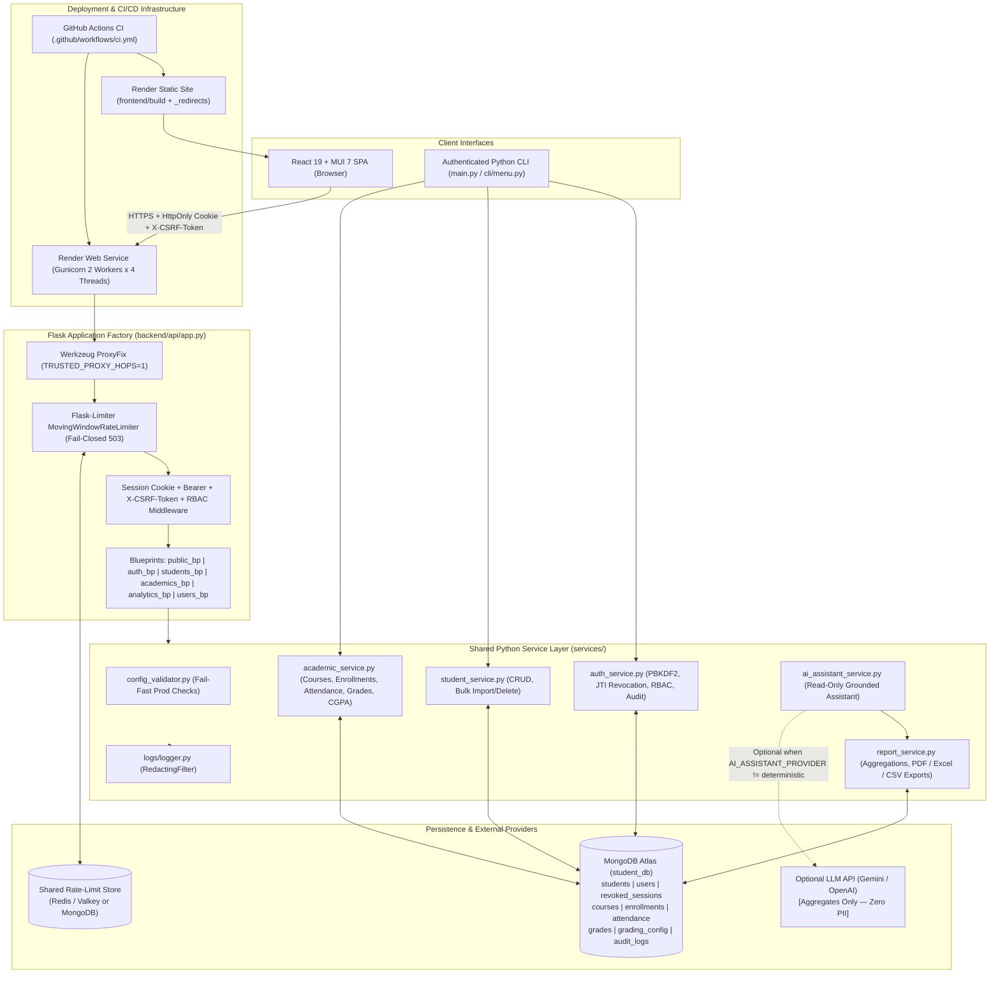

# Student Database Management System 2.0 (`v1.0.0`)

A full-stack, role-secured **Student Information & Academic Management Platform** built with **React 19**, **Material UI 7**, **React Router 6.30.6** (with v7 future flags), **Flask 3**, **Python 3.11+**, **MongoDB (PyMongo)**, **Flask-Limiter**, **ReportLab**, and **openpyxl**.

> **Suggested GitHub Repository Description:**
> Full-stack Student Information & Academic Management System built with React 19, Material UI 7, Flask, and MongoDB — featuring Admin/Faculty/Student RBAC, HttpOnly cookie + CSRF security, courses, enrollments, attendance, credit-weighted CGPA, PDF/Excel/CSV reporting, a grounded AI analytics assistant, and an authenticated CLI.
>
> **Suggested GitHub Topics:**
> `react` · `material-ui` · `flask` · `python` · `mongodb` · `pymongo` · `rbac` · `academic-management` · `student-information-system` · `analytics` · `reportlab` · `openpyxl` · `gunicorn` · `github-actions`

---

## 1. Project Overview & Key Features

| Domain | Capabilities |
| :--- | :--- |
| **SaaS Administrative Dashboard (`frontend/`)** | Responsive React 19 + Material UI 7 interface with persistent dark/light theme, KPI metric cards, Recharts data visualizations, global search, server-side pagination, and deep-linkable workspace routes (`/`, `/students`, `/academics`, `/attendance`, `/performance`, `/analytics`, `/reports`, `/logs`, `/settings`). |
| **Authentication & RBAC (`services/auth_service.py`)** | Salted `PBKDF2-HMAC-SHA256` (`260,000` iterations) password hashing, signed `HttpOnly` + `Secure` + `SameSite` session cookies (`studentdb_session`), `X-CSRF-Token` verification and rotation, MongoDB-backed multi-worker session revocation (`revoked_sessions` collection with TTL index), password-reset session invalidation (`tokens_valid_after`), zero-downtime key rotation (`SECRET_KEY` + `SECRET_KEY_PREVIOUS`), and strict server-side `Admin`, `Faculty`, and `Student` RBAC enforcement. |
| **Distributed Rate Limiting (`services/rate_limit_service.py`)** | Multi-worker moving-window rate limiting built on `Flask-Limiter` and `limits`, configurable via `RATELIMIT_STORAGE_URI` (`redis://`, `rediss://`, `mongodb://`, `mongodb+srv://`, or `memory://` in local dev/tests only), proxy-hardened client IP extraction (`Werkzeug ProxyFix` with `TRUSTED_PROXY_HOPS=1`), SHA-256 IP key hashing (`rl:<scope>:<sha256_ip>`), and a fail-closed (`HTTP 503`) production policy when shared storage is unavailable. |
| **Student Directory (`services/student_service.py`)** | Full CRUD for student profiles (`reg_no`, `roll_no`, `name`, `age`, `branch`, `email`, `phone`, `semester`, `academic_year`, `status`, `gpa`, `attendance_pct`), multi-field filtering, sorting, pagination, bulk CSV import, and bulk delete. |
| **Academic Management (`services/academic_service.py`)** | Dedicated MongoDB collections for `courses`, `enrollments`, `attendance`, `grades`, and `grading_config`. Supports course capacity and archiving, duplicate-safe student enrollments, classroom roll-call attendance (`Present`, `Absent`, `Late`, `Excused`), weighted assessment grading, configurable letter-grade scales, and credit-weighted GPA/CGPA computation. |
| **Analytics & Multi-Format Exports (`services/report_service.py`)** | Branch, semester, academic-year, and course performance breakdowns; live dataset preview; and one-click `.pdf` (`ReportLab`), `.xlsx` (`openpyxl`), and `.csv` exports protected against spreadsheet formula injection (`=`, `+`, `-`, `@`, `\t`, `\r`, `\n`) and path traversal. |
| **Grounded AI Analytics Assistant (`services/ai_assistant_service.py`)** | Read-only natural-language analytics assistant supporting zero-key `deterministic` mode out of the box plus optional backend-only `gemini` and `openai` providers. Strictly grounded in RBAC-scoped aggregate statistics — never exposes raw student PII or mutates database records. |
| **Authenticated Python CLI (`main.py`, `cli/menu.py`)** | Interactive terminal workflow sharing the same Python service layer and enforcing the same login and `Admin` / `Faculty` / `Student` RBAC rules as the REST API. |

---

## 2. System Architecture Diagram



---

## 3. Installation & Local Setup (Windows & Linux/macOS)

### Prerequisites
- **Python**: `3.11+` (CI and Render target `3.11.9`)
- **Node.js & npm**: `Node 20+` and `npm 10+`
- **MongoDB**: Local MongoDB Community Server (`mongodb://127.0.0.1:27017`) or MongoDB Atlas (`mongodb+srv://...`). Automated tests run in isolated in-memory mode (`STUDENTDB_TEST_MODE=1`) and require no external database.

### 3.1 Windows (PowerShell)
```powershell
# 1. Clone the repository
git clone https://github.com/Sagnik0310/Student-Database-Management.git
cd Student-Database-Management

# 2. Create and activate a Python virtual environment
python -m venv .venv
.\.venv\Scripts\Activate.ps1

# 3. Install backend dependencies and test runner
python -m pip install --upgrade pip
pip install -r requirements.txt pytest

# 4. Copy the environment template and configure local values
Copy-Item .env.example config.env

# 5. Start the Flask API server (http://localhost:10000)
python backend/api/app.py
```

Open a second PowerShell terminal for the React frontend:
```powershell
cd frontend
Copy-Item .env.example .env
npm ci
$env:VITE_API_URL="http://localhost:10000"
npm start
```

### 3.2 Linux / macOS (Bash)
```bash
# 1. Clone the repository
git clone https://github.com/Sagnik0310/Student-Database-Management.git
cd Student-Database-Management

# 2. Create and activate a Python virtual environment
python3 -m venv .venv
source .venv/bin/activate

# 3. Install backend dependencies and test runner
python -m pip install --upgrade pip
pip install -r requirements.txt pytest

# 4. Copy the environment template and configure local values
cp .env.example config.env

# 5. Start the Flask API server (http://localhost:10000)
python backend/api/app.py
```

Open a second terminal for the React frontend:
```bash
cd frontend
cp .env.example .env
npm ci
VITE_API_URL="http://localhost:10000" npm start
```

### 3.3 Running the Interactive Python CLI
```bash
python main.py
```
The CLI prompts for a username and password (`admin`, `faculty_cse`, or `student_demo` in local development) and enforces role permissions on every menu operation.

---

## 4. Safe Environment Configuration

Copy [.env.example](file:///d:/Student_Database/.env.example) to `config.env` (or `.env`) for local development. **Never commit `.env` or `config.env` to version control.**

| Variable | Required in Prod | Default (Dev) | Purpose |
| :--- | :--- | :--- | :--- |
| `APP_ENV` | Yes (`production`) | `development` | Enables fail-fast production validation in `services/config_validator.py`. |
| `FLASK_DEBUG` | Yes (`false`) | `false` | Disables the Werkzeug interactive debugger in production. |
| `PORT` | No | `10000` | HTTP listening port for Flask / Gunicorn. |
| `MONGO_URI` | **Yes** | — | MongoDB connection string (`mongodb://...` or `mongodb+srv://...`). |
| `DB_NAME` | Yes | `student_db` | Target MongoDB database name. |
| `SECRET_KEY` | **Yes** (`>=32` chars) | Ephemeral dev key | HMAC-SHA256 signing secret for session and CSRF tokens. Rejects known placeholders in production. |
| `SECRET_KEY_PREVIOUS` | Optional (`>=32` chars) | Empty | Optional prior signing key accepted during zero-downtime key rotation. |
| `SESSION_TTL_SECONDS` | No | `28800` (8h) | Session lifetime in seconds (`60` to `604800`). |
| `COOKIE_SECURE` | **Yes (`true`)** | `false` (HTTP dev) | Marks the `studentdb_session` cookie `Secure` (HTTPS-only). |
| `COOKIE_SAMESITE` | Yes (`None` or `Lax`) | `Lax` | `None` for cross-origin HTTPS SPA-to-API cookies; `Lax` for same-site deployments. |
| `CORS_ORIGINS` | **Yes** (`https://...`) | `http://localhost:3000` | Comma-separated allowed origins. Wildcard `*`, `http://`, and trailing slashes are rejected in production. |
| `RATELIMIT_STORAGE_URI` | **Yes** (or falls back to `MONGO_URI`) | `memory://` | Shared rate-limit backend (`redis://...`, `rediss://...`, `mongodb://...`, `mongodb+srv://...`). `memory://` is forbidden in production. |
| `RATELIMIT_FAIL_CLOSED` | Yes (`true`) | `true` | Rejects protected requests with `HTTP 503` if the shared rate-limit backend is unreachable. |
| `TRUSTED_PROXY_HOPS` | No | `1` | Number of reverse-proxy hops trusted by Werkzeug `ProxyFix` for `X-Forwarded-For` and `X-Forwarded-Proto`. |
| `ALLOW_DEFAULT_DEMO_USERS` | Yes (`false`) | `true` (dev only) | Prevents auto-creation of demo `Faculty`/`Student` accounts in production. |
| `ADMIN_USERNAME` / `ADMIN_PASSWORD` | Recommended (`>=12` chars) | `admin` / dev demo | Initial Admin bootstrap credentials. Production rejects weak/demo values (`Admin@123`, `<12` chars). |
| `AI_ASSISTANT_PROVIDER` | No | `deterministic` | `deterministic` (no API key required), `gemini`, or `openai`. |
| `AI_ASSISTANT_API_KEY` | Only if `gemini`/`openai` | Empty | Backend-only LLM API key (never exposed to the frontend). |
| `MAX_EXPORT_ROWS` / `MAX_DATE_RANGE_DAYS` | No | `2000` / `366` | Server-side resource caps on report exports and date filters. |

**Frontend Build-Time Environment Variable ([frontend/.env.example](file:///d:/Student_Database/frontend/.env.example))**:
- `VITE_API_URL`: Backend base URL (e.g., `https://<your-backend-service>.onrender.com`). Embedded into the static bundle at `npm run build` time. (Backward-compatible fallback to `REACT_APP_API_URL` is preserved).

---

## 5. Data Model & Academic Calculation Formulas

### 5.1 MongoDB Collections & Indexes (`database/db_connection.py`)
1. **`students`**: `{ reg_no (unique), roll_no, name, age, branch, email, phone, semester, academic_year, admission_date, status, gpa, attendance_pct, created_at, updated_at }`
   - Indexes: `reg_no` (unique), `branch`, `status`, `(branch, semester, status)`.
2. **`users`**: `{ username (unique), password_hash, role ("Admin"|"Faculty"|"Student"), full_name, email, assigned_branches, assigned_reg_nos, linked_reg_no, is_active, tokens_valid_after, created_at, updated_at }`
   - Index: `username` (unique).
3. **`revoked_sessions`**: `{ jti (unique), username, revoked_at, expires_at }`
   - Indexes: `jti` (unique), `expires_at` (TTL index with `expireAfterSeconds=0`).
4. **`courses`**: `{ course_code (unique), course_name, branch, credits, semester, academic_year, faculty_username, capacity, status ("Active"|"Archived"), description, created_at, updated_at }`
   - Indexes: `course_code` (unique), `(branch, semester, status)`, `faculty_username`.
5. **`enrollments`**: `{ enrollment_id (unique), reg_no, course_code, semester, academic_year, status ("Enrolled"|"Dropped"|"Completed"), enrolled_by, enrolled_at }`
   - Indexes: `(reg_no, course_code)` (unique compound), `course_code`.
6. **`attendance`**: `{ attendance_id (unique), reg_no, course_code, date (YYYY-MM-DD), session, status ("Present"|"Absent"|"Late"|"Excused"), remarks, recorded_by, updated_at }`
   - Indexes: `(reg_no, course_code, date, session)` (unique compound), `(course_code, date)`.
7. **`grades`**: `{ grade_id (unique), reg_no, course_code, assessment_type, marks_obtained, max_marks, weightage, percentage, letter_grade, grade_points, semester, academic_year, recorded_by, updated_at }`
   - Indexes: `(reg_no, course_code, assessment_type)` (unique compound), `course_code`.
8. **`grading_config`**: `{ config_id ("default_grading_scale"), scale_name, max_gpa_points, bands: [{ min_pct, letter, points }], late_attendance_weight, min_attendance_Requirement_pct, updated_at }`.
9. **`audit_logs`**: `{ id, action, actor, role, details, status, ip_address, timestamp }`
   - Index: `timestamp` (descending).

### 5.2 Attendance Percentage Formula
$$\text{Attendance \%} = \frac{\text{Present} + (\text{Late} \times w_{\text{late}})}{\text{Present} + \text{Absent} + \text{Late}} \times 100$$
- **Default Late Weight**: $w_{\text{late}} = 0.5$ (configurable in `grading_config.late_attendance_weight`).
- **Excused Sessions**: Excluded from the denominator (`effective_sessions = Present + Absent + Late`) so documented medical or institutional absences do not penalize a student's standing. If a student has only `Excused` sessions (`effective_sessions == 0`), attendance defaults to `100.0%`.

### 5.3 Course Percentage, Letter Grade & Credit-Weighted GPA/CGPA Formula
1. **Course Percentage**:
   $$\text{Course \%} = \frac{\sum \text{marks\_obtained}}{\sum \text{max\_marks}} \times 100$$
2. **Letter Grade & Grade Points**: Mapped via the active `GradingScale` bands (default 10-point scale: `O = 10` for $\ge 90\%$, `A+ = 9` for $\ge 80\%$, `A = 8` for $\ge 70\%$, `B+ = 7` for $\ge 60\%$, `B = 6` for $\ge 50\%$, `C = 5` for $\ge 40\%$, `F = 0` for $< 40\%$).
3. **Credit-Weighted GPA / CGPA**:
   $$\text{CGPA} = \frac{\sum_{i} (\text{Credits}_i \times \text{GradePoints}_i)}{\sum_{i} \text{Credits}_i}$$
   Updating attendance or grades automatically recalculates and synchronizes the student's `attendance_pct` and credit-weighted `gpa` on their `students` document.

---

## 6. REST API Reference & Representative Payloads

All protected endpoints accept either the `HttpOnly` cookie (`studentdb_session`) + `X-CSRF-Token` header (for `POST`, `PUT`, `PATCH`, `DELETE`) or an `Authorization: Bearer <session_token>` header.

### 6.1 Health & Readiness Probes (Public)
- **`GET /health`** (aliases: `/api/v1/health`, `/health/live`, `/api/v1/health/live`) — Liveness probe (`200 OK`):
  ```json
  { "probe": "liveness", "status": "healthy", "success": true, "version": "2.0.0" }
  ```
- **`GET /health/ready`** (alias: `/api/v1/health/ready`) — Database readiness probe (`200 OK` when connected, `503 Service Unavailable` when disconnected):
  ```json
  { "database": "connected", "probe": "readiness", "status": "ready", "success": true, "version": "2.0.0" }
  ```

### 6.2 Authentication & Session Lifecycle
- **`POST /api/v1/auth/login`** (Rate limit: `10 / 60s`)
  - Request:
    ```json
    { "username": "admin", "password": "<admin-password>" }
    ```
  - Response (`200 OK`, sets `Set-Cookie: studentdb_session=...; HttpOnly; Secure; SameSite=None; Path=/`):
    ```json
    {
      "success": true,
      "message": "Login successful",
      "csrf_token": "b2f4...",
      "session_token": "eyJ...",
      "user": {
        "username": "admin",
        "role": "Admin",
        "full_name": "System Administrator",
        "assigned_branches": ["*"]
      }
    }
    ```
- **`POST /api/v1/auth/logout`** — Revokes the session `jti` in MongoDB `revoked_sessions` and clears the cookie (`200 OK`).
- **`POST /api/v1/auth/rotate-csrf`** (Rate limit: `20 / 60s`) — Issues a fresh session + CSRF token and revokes the previous `jti`.
- **`POST /api/v1/auth/reset-password`** (Rate limit: `8 / 60s`) — Updates the password hash and sets `tokens_valid_after` (nanosecond timestamp), invalidating all prior sessions for that user across all Gunicorn workers.
- **`GET /api/v1/auth/me`** — Returns the active user profile and bound `csrf_token`.

### 6.3 Student Records (`/students` & `/api/v1/students`)
- **`GET /api/v1/students?search=CSE&branch=CSE&status=Active&page=1&limit=25`** (`Admin`, `Faculty`, `Student` — RBAC-filtered)
- **`GET /api/v1/students/<reg_no>`** (`Admin`, assigned `Faculty`, or owning `Student`)
- **`POST /api/v1/students`** (`Admin` only)
  - Request:
    ```json
    {
      "reg_no": "REG2026105",
      "roll_no": "105",
      "name": "Riya Verma",
      "age": 20,
      "branch": "CSE",
      "semester": "4",
      "academic_year": "2025-2026",
      "email": "riya.verma@example.edu",
      "status": "Active"
    }
    ```
- **`PUT /api/v1/students/<reg_no>`** (`Admin` and assigned `Faculty`)
- **`DELETE /api/v1/students/<reg_no>`** (`Admin` only)
- **`POST /api/v1/students/bulk-import`** (`Admin` only, Rate limit: `10 / 60s`) & **`POST /api/v1/students/bulk-delete`** (`Admin` only, Rate limit: `15 / 60s`).

### 6.4 Academic Management (`/api/v1/*`)
- **Courses**: `GET /api/v1/courses`, `GET /api/v1/courses/<course_code>`, `POST /api/v1/courses` (`Admin`), `PUT /api/v1/courses/<course_code>` (`Admin`), `PATCH /api/v1/courses/<course_code>/archive` (`Admin`).
- **Enrollments**: `GET /api/v1/enrollments`, `POST /api/v1/enrollments` (`Admin`, assigned `Faculty`), `DELETE /api/v1/enrollments/<enrollment_id>` (`Admin`).
- **Attendance**: `GET /api/v1/attendance`, `POST /api/v1/attendance`, `PUT /api/v1/attendance`, `POST /api/v1/attendance/batch` (Rate limit: `30 / 60s`), `GET /api/v1/attendance/report`.
- **Grades & GPA**: `GET /api/v1/grades`, `POST /api/v1/grades`, `PUT /api/v1/grades`, `GET /api/v1/grades/gpa/<reg_no>`, `GET /api/v1/grades/report`, `GET|PUT /api/v1/academics/grading-scale`.

### 6.5 Advanced Analytics, Reports/Exports & Grounded AI Assistant
- **`GET /api/v1/analytics/advanced?branch=CSE&semester=4&start_date=2026-01-01&end_date=2026-06-30`** (Rate limit: `40 / 60s`)
- **`GET /api/v1/reports/preview?report_type=academic_transcript&branch=CSE`** (Rate limit: `40 / 60s`)
- **`GET|POST /api/v1/reports/export`** (Rate limit: `25 / 60s`) — Downloads `.pdf`, `.xlsx`, or `.csv` for `student_directory`, `course_enrollment`, `attendance_register`, `grade_sheet`, `academic_transcript`, or `executive_summary`.
- **`GET /api/v1/ai/status`** & **`POST /api/v1/ai/query`** (Rate limit: `20 / 60s`)
  - Request:
    ```json
    {
      "question": "Which courses have the lowest attendance and how many students are below 75%?",
      "filters": { "branch": "CSE" }
    }
    ```
  - Response (`200 OK`):
    ```json
    {
      "success": true,
      "provider": "deterministic",
      "intent": "attendance_risk",
      "action_blocked": false,
      "answer": "Based on the verified RBAC-scoped dataset ...",
      "verified_metrics": { "total_students": 12, "below_75_attendance_count": 2 }
    }
    ```

---

## 7. Security Architecture & Dependency Risk Disclosure

### 7.1 Role-Based Access Control (RBAC) Matrix
| Capability | Admin | Faculty | Student |
| :--- | :---: | :---: | :---: |
| Manage users, courses, grading scale, bulk import/delete, audit logs | Allowed | Denied (`403`) | Denied (`403`) |
| View/update students in assigned branches (`assigned_branches`) | All branches | Assigned only | Own `linked_reg_no` (read-only) |
| Enroll students & record attendance/grades in assigned courses | All courses | Assigned `faculty_username` / branch only | Denied (`403`) |
| Analytics, PDF/Excel/CSV exports & AI Assistant | Institution-wide | Scoped to assigned courses/branches | Scoped strictly to own `linked_reg_no` |

### 7.2 Session Revocation, CSRF & Secret Protection
- **Multi-Worker Session Revocation**: Every session token includes a unique `jti` and nanosecond issuance timestamp (`iat_ns`). Logout writes the `jti` to MongoDB `revoked_sessions`; password reset writes `tokens_valid_after` to MongoDB `users`. In non-test mode, if MongoDB is unreachable during verification, `is_session_revoked()` and `get_user_by_username()` **fail closed** (`401 Unauthorized`).
- **CSRF Defense**: Cookie-authenticated `POST`, `PUT`, `PATCH`, and `DELETE` requests (including `/api/v1/auth/logout`) require a matching `X-CSRF-Token` header verified in constant time via `hmac.compare_digest`.
- **Log Redaction**: `logs/logger.py` applies `RedactingFilter` across all log handlers, scrubbing `mongodb://`, `mongodb+srv://`, `redis://`, and `rediss://` credentials, `Authorization: Bearer` tokens, `studentdb_session` cookies, passwords, CSRF tokens, and API keys. Student creation logs record only `reg_no` and `branch` (never student names, emails, or phone numbers).

### 7.3 Remaining Frontend Dependency Risks (`npm audit` Disclosure)
Running `npm audit` in `frontend/` currently reports **38 advisories** (**0 Critical, 13 High, 9 Moderate, 16 Low**), reduced from 64 (3 Critical) via safe `npm audit fix`:
1. **`react-router@6.30.6` / `react-router-dom@6.30.6` (2 Moderate advisories: `GHSA-337j-9hxr-rhxg`, `GHSA-wrjc-x8rr-h8h6`)**:
   - `GHSA-337j-9hxr-rhxg` affects only SSR `deserializeErrors()` hydration (not used in this client-side `<BrowserRouter>` SPA).
   - `GHSA-wrjc-x8rr-h8h6` affects open redirects when untrusted user input is passed to `<Link>` or `useNavigate()`; all navigation calls in `Navbar.js` and `Dashboard.js` use hardcoded internal route constants.
   - Upgrading to `react-router-dom@7.18.5` requires migrating the test runner from CRA's bundled Jest 27 (`react-scripts@5.0.1`), which cannot resolve `react-router/dom` subpath exports.
2. **`react-scripts@5.0.1` Build/Test Tooling Tree (36 advisories: 13 High, 7 Moderate, 16 Low)**:
   - Includes `webpack-dev-server@4.15.2`, `webpack-dev-middleware@5.3.4`, `postcss@7.0.39` (in `resolve-url-loader`), `svgo@1.3.2` / `nth-check@1.0.2`, `serialize-javascript` (in `workbox-build` / `css-minimizer-webpack-plugin`), `bfj` / `underscore`, and `jest@27.5.1`.
   - **Impact & Mitigation**: None of these packages are bundled into the static production browser output (`frontend/build/`). However, `webpack-dev-server` / `postcss` / `svgo` run during local development (`npm start`) and CI builds (`npm run build`). Do not expose `npm start` to untrusted networks or process untrusted third-party SVG/source-map files; migrating from `react-scripts@5.0.1` to **Vite + Vitest** is planned as the next build-tooling upgrade to eliminate all 38 advisories.

---

## 8. Testing, CI/CD, Render Deployment & Disaster Recovery

### 8.1 Local Verification Commands
```bash
# Backend dependency check, bytecode compilation & 51-test isolated pytest suite
pip check
python -m compileall -q backend database logs models services cli tests main.py
STUDENTDB_TEST_MODE=1 python -m pytest tests/ -v

# Frontend clean install, 14-test React Testing Library suite & production build
cd frontend
npm ci
CI=true npm test -- --watchAll=false
npm run build
```

### 8.2 GitHub Actions CI/CD ([.github/workflows/ci.yml](file:///d:/Student_Database/.github/workflows/ci.yml))
Triggers on every `push` and `pull_request` to `main`/`master` with `permissions: contents: read`:
- **`backend` job (`ubuntu-latest`, Python `3.11`)**: `pip install -r requirements.txt pytest` -> `pip check` -> `python -m compileall` -> `STUDENTDB_TEST_MODE=1 python -m pytest tests/ -v --tb=short`.
- **`frontend` job (`ubuntu-latest`, Node `20`)**: `npm ci` -> `CI=true npm test -- --watchAll=false` -> `CI=true npm run build`.

### 8.3 Render Deployment Configuration ([render.yaml](file:///d:/Student_Database/render.yaml))
1. **Backend Web Service (`student-management-backend`)**:
   - **Build Command**: `pip install -r backend/api/requirements.txt`
   - **Start Command**: `gunicorn backend.api.app:app --workers 2 --threads 4 --timeout 60`
   - **Health Check Path**: `/health`
   - **Required Render Dashboard Environment Variables (`sync: false`)**:
     - `MONGO_URI`: MongoDB Atlas URI (`mongodb+srv://...`)
     - `RATELIMIT_STORAGE_URI`: Shared Redis/Valkey URI (`redis://...` or `rediss://...`) or shared MongoDB URI (`mongodb+srv://...`)
     - `CORS_ORIGINS`: Exact HTTPS frontend origin without a trailing slash (e.g., `https://<your-frontend>.onrender.com`)
     - `ADMIN_PASSWORD`: Strong (`>=12` chars) initial Admin password
     - `SECRET_KEY`: Auto-generated (`generateValue: true`) or manually set `>=32`-char secret
2. **Frontend Static Site**:
   - **Root Directory**: `frontend`
   - **Build Command**: `npm ci && npm run build`
   - **Publish Directory**: `build`
   - **Environment Variable**: `VITE_API_URL=https://<your-backend>.onrender.com` (embedded at build time; run **Clear build cache & deploy** after changing; `REACT_APP_API_URL` also supported for backward compatibility)
   - **Rewrite Rule**: [frontend/public/_redirects](file:///d:/Student_Database/frontend/public/_redirects) (`/* /index.html 200`) is automatically copied to `frontend/build/_redirects`.

### 8.4 MongoDB Backup, Restore & Application Rollback
- **Create Compressed Backup Archive**:
  ```bash
  mongodump --uri="$MONGO_URI" --db=student_db --archive=backup_student_db_$(date +%Y%m%d_%H%M%S).gz --gzip
  ```
- **Restore from Backup Archive**:
  ```bash
  mongorestore --uri="$MONGO_URI" --nsInclude="student_db.*" --archive=backup_student_db_<timestamp>.gz --gzip --drop
  ```
- **Rollback**: All indexes and collections introduced in Phases 1–5 are additive and backward-compatible. To roll back a release on Render, select the previous known-good deploy in the Render Dashboard (**Deploys -> Roll back to this deploy**).

### 8.5 Reproducible 12-Step Live Smoke-Test Checklist
Execute against a staging database or using the designated synthetic test record `REG_SMOKE_TEST_001` (never modify real student records):
1. **Liveness (`GET /health/live`)**: Verify `200 OK` and `{"probe":"liveness","status":"healthy"}`.
2. **Readiness (`GET /health/ready`)**: Verify `200 OK` and `{"database":"connected","probe":"readiness","status":"ready"}` with no internal URI details.
3. **Deep-Link SPA Routing**: Load `https://<frontend>.onrender.com/reports/export` in an incognito window -> Verify `200 OK` and `StudentDB 2.0 Portal` login view.
4. **Admin Login**: Sign in as `Admin` and verify dashboard KPIs load.
5. **Cookie & CSRF Inspection**: Confirm `studentdb_session` has `HttpOnly`, `Secure`, `SameSite=None`, and state-changing requests carry `X-CSRF-Token`.
6. **Designated Test Student CRUD**: Create `REG_SMOKE_TEST_001`, update its semester, verify in the directory, and delete `REG_SMOKE_TEST_001` at the end of the smoke test.
7. **Faculty & Student RBAC**: Verify `Faculty` receives `403` on unassigned branches/courses and `Student` can access only their `linked_reg_no`.
8. **Academic Workflow**: Enroll `REG_SMOKE_TEST_001` in a test course, record attendance (`Present`) and a grade, and verify attendance % and CGPA calculation.
9. **Exports**: Download `.pdf`, `.xlsx`, and `.csv` reports from `/reports` and confirm valid file headers.
10. **Deterministic AI Assistant**: Run a starter prompt in `/analytics` without an external API key and confirm `provider: "deterministic"`.
11. **Logout & Replay Rejection**: Log out, then replay the logged-out Bearer/cookie token against `GET /api/v1/auth/me` -> Confirm `401 Unauthorized`.
12. **Log Hygiene**: Inspect Render logs and confirm zero credentials, tokens, or student PII dumps appear.

---

## 9. Portfolio Screenshot Checklist

Capture the following screenshots (using synthetic demo records only) when preparing release marketing or portfolio assets:
- [ ] **1. Login Portal (`/`)**: Dark-mode and light-mode views of the `StudentDB 2.0 Portal` authentication card.
- [ ] **2. Executive Dashboard (`/`)**: KPI summary cards, branch distribution bar chart, and quick-action toolbar.
- [ ] **3. Student Directory (`/students`)**: Multi-filter student table with pagination, status chips, and Add/Edit modal.
- [ ] **4. Academic Catalog & Enrollments (`/academics`)**: Course cards, credit hours, capacity indicators, and student enrollment dialog.
- [ ] **5. Classroom Roll-Call Attendance (`/attendance`)**: Session attendance marking table (`Present`, `Absent`, `Late`, `Excused`) and attendance percentage summary.
- [ ] **6. Grades, Transcript & Grading Scale (`/performance`)**: Assessment grade entry, credit-weighted CGPA standing, and configurable grading scale table.
- [ ] **7. Advanced Analytics & Grounded AI Assistant (`/analytics`)**: Multi-dimensional performance charts alongside the read-only AI Analytics Assistant panel displaying verified metrics.
- [ ] **8. Live Report Preview & Exports (`/reports`)**: Tabular report preview with `.pdf`, `.xlsx`, and `.csv` download actions.
- [ ] **9. Security Audit Trail (`/logs`)**: Immutable admin audit log view showing `LOGIN_SUCCESS`, `STUDENT_CREATED`, `REPORT_EXPORTED`, and `LOGOUT` events.

---

## 10. Version `v1.0.0` Release Notes

### Completed Changes in `v1.0.0`
- **Phase 1 (SaaS Frontend & Core API)**: Redesigned React 19 + Material UI 7 dashboard with dark/light mode, responsive drawer navigation, server-side search/filter/pagination, and bulk student import/delete.
- **Phase 2 (Authentication, RBAC & Cookie/CSRF Security)**: Implemented `PBKDF2-HMAC-SHA256` password hashing, `HttpOnly` + `Secure` + `SameSite` session cookies, `X-CSRF-Token` validation and rotation, `Admin`/`Faculty`/`Student` RBAC across both Web API and CLI, and removed legacy `frontend - Copy/`.
- **Phase 3 (Academic Management System)**: Added `courses`, `enrollments`, `attendance`, `grades`, and `grading_config` collections with idempotent indexes, duplicate prevention, configurable attendance late-weight formula, and credit-weighted GPA/CGPA synchronization.
- **Phase 4 (Advanced Analytics, Exports & AI Assistant)**: Built multi-dimensional analytics endpoints, live report previews, formula-injection-safe `.pdf` / `.xlsx` / `.csv` exports, and a read-only grounded AI Analytics Assistant (`deterministic`, `gemini`, `openai`).
- **Phase 5 & Release Hardening (CI/CD, Multi-Worker Security & Shared Rate Limiting)**:
  - Added GitHub Actions CI (`.github/workflows/ci.yml`), Dependabot (`.github/dependabot.yml`), and centralized production config validation (`services/config_validator.py`).
  - Added MongoDB-backed multi-worker session revocation (`revoked_sessions`), password-reset session invalidation (`tokens_valid_after`), zero-downtime key rotation (`SECRET_KEY_PREVIOUS`), and fail-closed revocation checks.
  - Replaced per-worker in-memory rate limiting with `Flask-Limiter` (`services/rate_limit_service.py`) supporting shared Redis/MongoDB storage (`RATELIMIT_STORAGE_URI`), `Werkzeug ProxyFix` IP extraction, SHA-256 IP hashing, and fail-closed `HTTP 503` enforcement.
  - Hardened production user bootstrap (`services/auth_service.py`) so default demo passwords are never used in production.
- **Frontend Tooling Modernization (CRA to Vite & Vitest Migration)**:
  - Migrated frontend build tooling from Create React App (`react-scripts@5.0.1` and Jest 27) to Vite 8 and Vitest.
  - Upgraded `react-router-dom` to `^7.18.5`.
  - Preserved React 19, Material UI 7, full test suite (14 passing tests), SPA redirect fallback (`build/_redirects`), and backward compatibility with `REACT_APP_API_URL` alongside `VITE_API_URL`.
  - Completely eliminated all 38 npm advisories (`npm audit` now reports 0 vulnerabilities).

### Known Limitations
- **Local Python Version vs. Production Target**: Local verification was executed on Python `3.14.7`; GitHub Actions CI and Render target Python `3.11` (`3.11.9`).

### Upgrade Instructions (from Pre-v1.0 Deployments)
1. Back up your MongoDB database using `mongodump` (Section 8.4).
2. Install updated Python dependencies (`pip install -r requirements.txt`) and frontend packages (`cd frontend && npm ci`).
3. Configure the new required production environment variables (`SECRET_KEY`, `CORS_ORIGINS`, `RATELIMIT_STORAGE_URI`, `ADMIN_PASSWORD`, `ALLOW_DEFAULT_DEMO_USERS=false`).
4. Deploy the backend and trigger a **Clear build cache & deploy** on the Render Static Site so `VITE_API_URL` (or `REACT_APP_API_URL`) and `public/_redirects` are bundled. All database indexes are created idempotently on startup without modifying existing student records.
